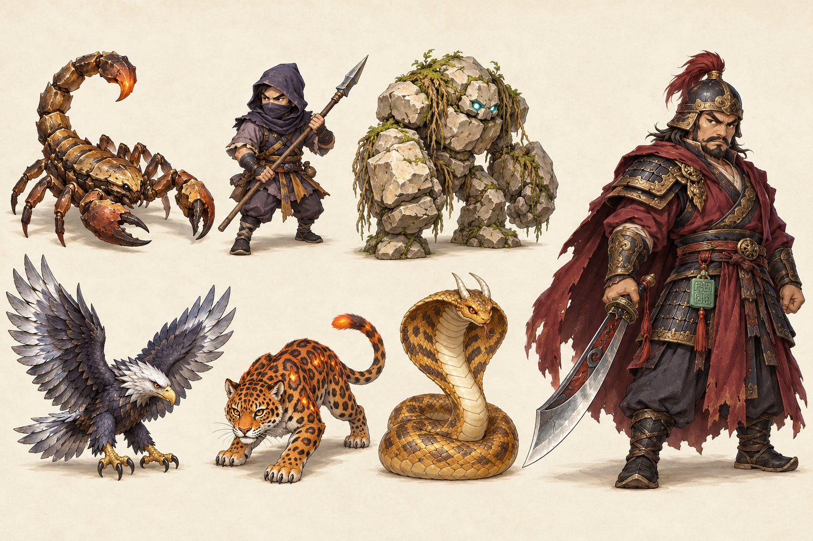
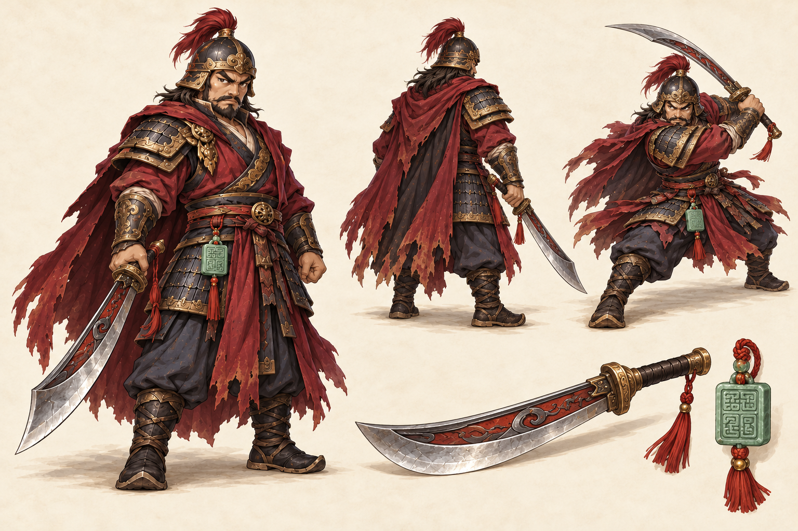

# มอนสเตอร์ด่าน 2 — ด่านผาหลิว แบบใหม่

ออกแบบวันที่ 25 ตุลาคม 2026 ตามแนวทาง [มอนสเตอร์หมู่บ้านเซียนน้อย](village-monsters-v2-design.md) และ [ฉากด่านผาหลิว](hunting-maps-v3.md): ภาพวาดลงสี 2D chibi wuxia มุมกล้องสูงสามส่วน วัสดุและเงามีรายละเอียด รูปร่างอ่านง่ายเมื่อย่อในเกม

สถานะ: ผลิตและเชื่อมสไปรต์ใหม่กับตัวเกมครบมอนสเตอร์ทั่วไป 6 ชนิดและบอส 1 ตัวแล้ว ตัวละ 32 เฟรม รวม 224 เฟรม สร้างด้วย built-in image_gen โดยยึด ID ชื่อ เลเวล และชนิดจาก `shared/world-data.js` ส่วนค่าสถานะ สกิล ของดรอป จุดเกิด และขนาดในเกมคงเดิม

## ภาพออกแบบ

ภาพด้านซ้ายเรียงจากซ้ายไปขวา: แถวบน Lv.22, 25, 28; แถวล่าง Lv.32, 36, 40 ด้านขวาคือบอส Lv.45 ขนาดในภาพใช้เน้นลำดับความสำคัญของงานออกแบบ ไม่ใช่มาตราส่วนในเกม

## แนวทางภาพรวม

- ใช้หินปูนเทาอุ่น ขอบหินครีม ทรายทองแดงหม่น มอสเขียวหลิว ผ้าครามถ่าน และเหล็กดำ เพื่อเข้ากับทางคาราวาน หอสัญญาณ และประตูเมฆา
- ให้ขอบสว่างของหินและเหล็กช่วยแยกตัวจากพื้นดิน สัตว์สีทรายต้องมีรอยต่อและเงาท้องเข้ม ส่วนโจรต้องเห็นอาวุธแยกจากลำตัว
- เพิ่มความน่าเกรงขามจากด่านแรกด้วยเปลือกแข็ง รูปร่างหนัก และเครื่องแต่งกายนักรบ ยังรักษาสัดส่วนกระชับในโลกเดียวกัน
- แสงสีใช้เฉพาะจุด เช่น ตายักษ์หิน เหล็กใน และปลายหางเสือดาว เพื่อให้เห็นตัวและวงเตือนบนพื้นชัด

## ตัวละครทั้งชุด

| ID / เลเวลเดิม | ชื่อ | แบบใหม่และจุดจำ | แนวทางท่าเคลื่อนไหว |
|---|---|---|---|
| scorpion / 22 | แมงป่องผาทราย | เปลือกสีทรายสำริดเป็นชั้น ข้อต่อเข้ม ก้ามคู่ใหญ่ ขาเดิน 8 ขา หางปล้องเดียวยกเหนือหลัง ปลายเหล็กในส้มอำพัน | เดินสลับขาด้วยลำตัวต่ำ โจมตีกระแทกก้ามไปด้านหน้า หางโค้งคงรูปและไม่บังหัว |
| passbandit / 25 | โจรคลุมหน้าด่านผา | ฮู้ดกับผ้าปิดหน้าครามถ่าน เสื้อชายขาดจากฝุ่นทางคาราวาน ขอบผ้าเหลืองหม่น ถุงเสบียงเล็ก หอกไม้ปลายเหล็กหนึ่งเล่ม | ยืนย่อเข่า เดินจับหอกสองมือ โจมตีแทงหอกตรง ให้ปลายหอกอยู่ครบเฟรม |
| golem / 28 | ยักษ์หินผาหลิว | หินปูนก้อนใหญ่มีชั้นแตก หัวเล็กจมระหว่างไหล่ แขนหนัก ตาฟ้าอมเขียว มอสกับรากหลิวติดตามซอก | เดินถ่ายน้ำหนักช้า แขนแกว่งสวนขา โจมตีทุบหมัดหนึ่งข้าง หินและรากติดกับตัว |
| ironeagle / 32 | อินทรีปีกเหล็ก | ขนเทาถ่าน หงอนเงิน ปลายขนปีกเหมือนใบเหล็กซ้อน จะงอยปากและกรงเล็บทอง รูปร่างนกชัด | ยืนกางปีกครึ่งหนึ่ง เคลื่อนที่กระพือปีกต่ำ โจมตีโน้มตัวใช้กรงเล็บ หลีกเลี่ยงกางปีกจนชนช่องข้างเคียง |
| fireleopard / 36 | เสือดาวลายเพลิง | เสือดาวสี่ขาทรงเพรียว สีส้มอำพัน ลายดอกกุหลาบน้ำตาลเข้ม อกครีม ลายเพลิงแทรกบางจุด ปลายหางแต้มแสงส้ม | เดินสลับขาคู่ทแยง โจมตีตะปบด้วยขาหน้า ไม่ใช้ลายพาดแบบเสือโคร่งและไม่เพิ่มกลุ่มไฟรอบตัว |
| sandnaga / 40 | นาคาผาทรายทอง | เกล็ดทองทราย ท้องงาช้าง แม่เบี้ยกว้างลายสันทรายสำริด เขางาช้างสั้นคู่เอนไปหลัง ขดลำตัวหนา | เลื้อยขดสลับซ้ายขวา โจมตียืดคอฉก รักษาความต่อเนื่องของลำตัว ไม่มีแขน ขา หรือปีก |
| banditlord / 45 | ขุนโจรดาบโลหิต | มนุษย์ไหล่กว้าง หนวดเคราดำ หมวกเหล็กพู่แดงคล้ำ เสื้อแดงเลือดหมู เกราะเหล็กดำขอบทองเก่า ผ้าคลุมผ่าชาย ดาบโค้งคมเดียว ตราหยกคาราวานที่เอว | เดินหนักแน่น ผ้าคลุมแกว่งตามขา เตรียมฟันบิดไหล่และย่อเข่า โจมตีฟันดาบหนึ่งครั้งโดยให้มือจับด้ามต่อเนื่อง |

## บอส: ขุนโจรดาบโลหิต

หัวหน้าโจรคุมเส้นทางคาราวาน มีเอกลักษณ์จากดาบโค้งใหญ่ เสื้อแดงคล้ำ และเกราะเหล็กขอบสำริด ตราหยกสื่อถึงของที่ยึดจากคาราวาน หมวกเปิดใบหน้าให้เห็นคิ้วและหนวดเครา ผ้าคลุมแยกชายให้เห็นตำแหน่งขา ตัวบอสยังเป็นมนุษย์ตามข้อมูลเดิม

แผ่นรายละเอียดมีมุมหน้าสามส่วน มุมหลัง ท่าเตรียมฟัน และภาพแยกดาบกับตราหยก ใช้ตรวจความต่อเนื่องของชุด เกราะและอาวุธก่อนผลิต animation มุมหลังต้องไม่มีใบหน้า ห้ามสลับข้างมือจับดาบระหว่างเฟรมของทิศเดียวกัน

ท่าเตรียมฟันเป็นแนวทางงานภาพ ไม่ใช่สกิลใหม่ การเชื่อม animation ต้องใช้สัญญาณโจมตีและระบบบอสเดิม หากจะเพิ่มท่าโจมตีใหม่ต้องกำหนดเวลาร่าย พื้นที่โดน และ cooldown แยกต่างหาก

## ข้อกำหนดสไปรต์

1. สร้างไฟล์ RGBA พื้นโปร่งใสแยกต่อ ID โดยอ้างอิงภาพชุดนี้ ไม่ตัดตัวจากภาพ concept ไปใช้แทน animation
2. ตามแบบแผนด่านแรก: 8 ทิศ `S, SE, E, NE, N, NW, W, SW` × 4 แถว `walkA, idle, walkB, attack` รวม 32 เฟรมต่อชนิด หรือ 224 เฟรมทั้งด่านรวมบอส
3. ทุกทิศใช้กายวิภาคและวัสดุเดียวกัน เฟรมเดินสองข้างต้องมีท่าต่างจริง ภาพด้านหลังไม่วาดใบหน้าด้านหน้า ใช้สเกลเดียวกันตลอด animation ของแต่ละทิศ
4. ยึดจุดเท้าหรือฐานขดลำตัวคงที่ ตรวจแมงป่องครบขา/ก้าม/หาง อินทรีครบปีกและกรงเล็บ นาคามีลำตัวต่อเนื่อง และดาบ/หอกไม่หลุดจากมือ
5. ภาพ production ต้องไม่มีพื้นกระดาษ เงาพื้น ตาราง ตัวอักษร หรือเอฟเฟกต์ลอยแยก ใช้เงาที่ renderer วาดอยู่แล้ว ให้ขอบโปร่งใสพอสำหรับอาวุธ ปีก และหาง
6. รักษาความสูงในโลกเกมจาก `MON_ART.h × size`: แมงป่อง 44, โจร 80, ยักษ์หิน 92, อินทรี 72, เสือดาว 58, นาคา 67.6 และบอส 136 world pixels ห้ามใช้สัดส่วนในภาพรวมไปเปลี่ยน hitbox หรือระยะโจมตี
7. ลงทะเบียนไฟล์ runtime ใน `public/assets/monsters/index.json` พร้อม metadata ทิศ/แถว จุดยึด และเวอร์ชันแคชหลังตรวจครบเท่านั้น เก็บรายการด่านอื่นไว้
8. ก่อนนำเข้าเกม ตรวจครบ 224 เฟรม ความต่างของท่า ขอบ alpha และจุดยึด จากนั้นดูบนพื้นด่านผาหลิวจริงทั้งมุมหน้า/หลัง การเคลื่อนที่ โจมตี กระพริบเมื่อถูกตี และจางหาย ตรวจว่าใช้สไปรต์ใหม่จริง ไม่มีภาพสำรองหรือไฟล์โหลดล้มเหลว

## ไฟล์งาน

- [ภาพรวมมอนสเตอร์ 7 ชนิด](../monster-art/pass-v2/monster-lineup-concept.png)
- [ภาพรายละเอียดบอส](../monster-art/pass-v2/banditlord-concept.png)
- [Prompt ที่ใช้สร้างภาพจริง](../monster-art/pass-v2/PROMPTS.md)

## สไปรต์ที่ใช้ในเกม

- ต้นฉบับทั่วไป: `monster-art/pass-v2/<id>-source.png` ทั้ง 6 ชนิด พร้อม prompt ใน [SPRITES.json](../monster-art/pass-v2/SPRITES.json)
- บอสใช้ `banditlord-south-source.png` เฉพาะสามแถวแรก, `banditlord-north-source.png` ทั้งสี่แถว และ `banditlord-attack-source.png` สำหรับโจมตี S/SE/E/NE รวม 32 เฟรม แถวโจมตีเดิมของแผ่น south มี silhouette เชื่อมกันจึงไม่ถูกนำเข้า รายละเอียด prompt อยู่ใน [BANDITLORD-SPRITES-PROMPTS.md](../monster-art/pass-v2/BANDITLORD-SPRITES-PROMPTS.md)
- `npm run monsters:pass` ตรวจแหล่งภาพทั้งหมดก่อนเขียน runtime จัดขอบโปร่งใส จุดยึดฐาน และสเกลแต่ละทิศ ได้ `public/assets/monsters/<id>-v2.png` พร้อมเวอร์ชัน SHA-256 ใน `index.json`; เก็บรายการของด่านอื่นไว้
- เกมและหน้า art preview โหลด manifest ด้วย `?v=pass-monsters-v2` เพื่อข้ามแคช manifest ชุดเก่า แต่ละภาพใช้เวอร์ชันจากเนื้อภาพของตัวเอง

## ผลตรวจ

- `npm run check:monsters-pass`: ผ่านครบ 224 เฟรม ตรวจขอบโปร่งใส จุดยึดฐาน สเกล idle เฟรมไม่ซ้ำ เวอร์ชันแคช รายชื่อครบตามด่าน และรักษาขนาดในโลกเกม
- `node tools/preview-village.cjs 3904` และ `npm run check:monsters-pass-browser -- http://127.0.0.1:3904 9351`: ทดสอบ renderer จริงครบ 224 ทิศ/ท่า การกระพริบเมื่อถูกตีและจางหายทั้ง 7 ตัว โดยใช้ตัวละครจำลองบนเซิร์ฟเวอร์ที่ไม่บันทึกผู้เล่น
- ผลเบราว์เซอร์: procedural fallback 0, JavaScript errors 0, ไฟล์โหลดล้มเหลว 0 ตรวจภาพบนลานบอสด่านผาหลิวแล้ว
- การลงทะเบียนภาพอื่นทั้ง 8 ตัวตรงกับก่อนเปลี่ยนชุดนี้ และ `check:monsters-village` / `check:kingboar` ผ่าน
- ภาพตรวจและรายงาน: `artifacts/pass-monsters-v2/lineup.png`, `in-game.png`, `<id>-poses.png`, `check.json`
